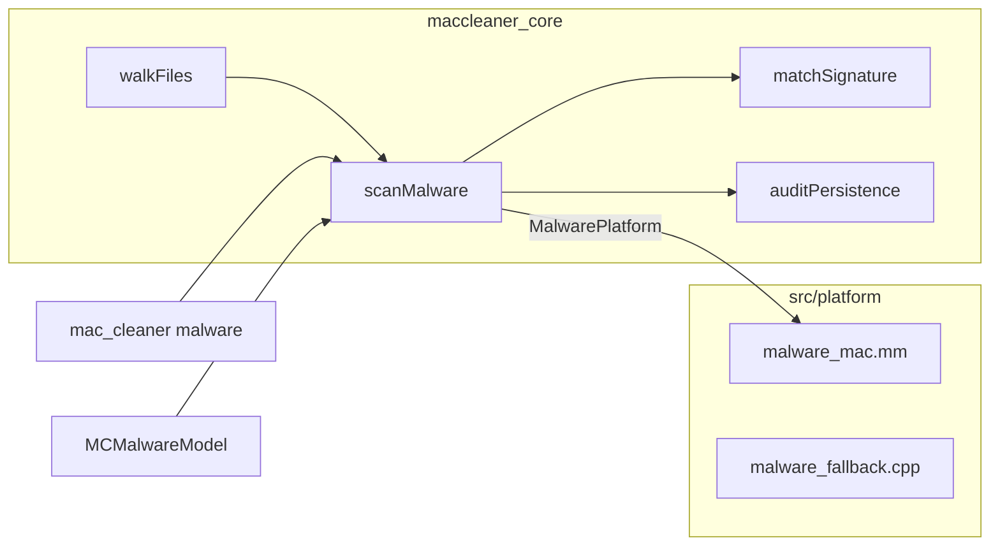

# Antivirus — design

Date: 2026-10-31. Branch: `antivirus-develop` (from `main`).

## Goal

Add an on-demand malware scan as a new sidebar tool. It reports known
macOS malware signatures and suspicious persistence. It is a
signature/heuristic scanner. It is not a real-time AV engine, and it does
not replace XProtect, which already runs on every Mac.

Success: a scan of the default roots finds a harmless EICAR test file, a
self-made quarantined ad-hoc binary, and a test LaunchAgent that points at
that binary. A user-selected finding moves to the Trash. Apple-signed
files and `/System` are never touched.

## Non-goals

- No YARA engine. `XProtect.yara` (508 rules, `import "hash"`, `uint32`
  conditions, regexes) needs libyara. That adds a dependency, and the
  project rule is "no dependencies beyond system frameworks".
- No ClamAV (GPL-2, about 300 MB database, weak macOS coverage).
- No real-time monitoring, no kernel or endpoint-security extension.
- No login items (BTM). `sfltool dumpbtm` output is not stable and parts
  need root.
- No `launchctl bootout` of a loaded agent. A trashed plist stops loading
  at the next login.
- No separate quarantine folder. The Trash is already reversible.

## Detection rules

Each finding has one severity: **Detected** (signature match),
**Suspicious** (heuristic) or **Info**.

### 1. Signatures (Detected)

- Rules come from
  `/Library/Apple/System/Library/CoreServices/XProtect.bundle/Contents/Resources/XProtect.plist`.
  On the reference Mac (macOS 27.2) it has 94 entries: 169 hex `Pattern`
  matches, 30 `Identity` (SHA-1) matches and 21 nested
  `MatchAny`/`MatchAll` groups.
- One built-in rule is always present: the EICAR test string. It lets the
  user test the scanner with a harmless file.
- An entry matches when all its `Matches` match. `MatchAny` needs one
  child, `MatchAll` needs all children.
- A hex pattern matches when the bytes occur anywhere in the file. Patterns
  use `??`, `{n}`, `{-n}` and `*` wildcards; an entry with an alternation
  `(a|b)` or an unknown `MatchFile` key is dropped. `MatchFile` constraints
  sit on each leaf, not on the entry. An identity matches when the SHA-1 of the whole file
  is equal.
- `NSURLFileSizeKey` must equal the file size; `NSURLNameKey` must equal
  the file name.
- `NSURLTypeIdentifierKey` `public.unix-executable` and
  `com.apple.mach-o-dylib` mean "has an execute bit or is Mach-O"; other
  UTIs are ignored.
- Files larger than 64 MB are skipped and counted in the report.

### 2. Persistence (Suspicious or Info)

Every scan reads the plists in `~/Library/LaunchAgents`,
`/Library/LaunchAgents` and `/Library/LaunchDaemons`. The target is
`Program`, else `ProgramArguments[0]`.

| Condition | Severity |
|---|---|
| Target is unsigned | Suspicious |
| Target is ad-hoc signed and quarantined | Suspicious |
| Target is ad-hoc signed, not quarantined (Homebrew services) | Info |
| Target is under `/tmp`, `/private/tmp` or `/Users/Shared` | Suspicious |
| Target is unsigned or ad-hoc signed and in a hidden directory (a path part that starts with `.`) | Suspicious |
| Target does not exist | Info |
| Target is Apple-signed or signed with a Developer ID | no finding |

A plist that cannot be read gives an Info finding.

### 3. Quarantined executables (Suspicious)

A Mach-O file with an execute bit in the scan roots that has the
`com.apple.quarantine` xattr and is unsigned or ad-hoc signed gives a
finding. (The execute bit keeps out object files, such as Blender's
`python.o`.) Homebrew does not set
the xattr, so its binaries do not match.

### 4. Never touched

- Files under `/System`.
- Apple-signed files (`anchor apple` requirement). They are not reported
  and cannot be trashed.
- TCC-protected directories. `walkFiles` skips a directory on EPERM.

## Scan roots

Default: `~/Downloads`, `~/Desktop`, `~/Applications`, `/Applications`.
The CLI takes `--path P` (repeatable) instead; the GUI has
"Choose Folder…". The persistence check always runs.

## Architecture

### Core: `include/maccleaner/malware.hpp`, `src/malware.cpp`

- `enum class Severity { Detected, Suspicious, Info }`.
- `enum class FindingKind { Signature, Persistence, Quarantine }`.
- `struct Finding { path, severity, kind, reason }`. For persistence,
  `path` is the plist.
- `struct SignatureMatch`: a hex pattern, a SHA-1, or an Any/All group of
  children. `struct Signature { name, optional size, match }`.
- `enum class SigningStatus { Apple, DeveloperSigned, AdHoc, Unsigned, Unknown }`.
- `struct MalwarePlatform` holds injected functions: `signingStatus(path)`,
  `hasQuarantine(path)`, `sha1(bytes)`, `readLaunchTarget(plist)`,
  `pathExists(path)`. This follows the `PathExistsFn` pattern of the
  optimizer, so tests use fake results.
- `MalwarePlatform defaultMalwarePlatform()` and
  `std::vector<Signature> loadXProtectRules()` come from the platform
  file. The EICAR rule is always added.
- `MalwareReport scanMalware(roots, rules, platform, cancelled, progress)`
  returns the findings, the number of scanned files and the number of
  skipped large files.
- `bool matchSignature(const Signature&, bytes, sha1)` is pure and tested.

### Platform: `src/platform/malware_mac.mm`, `malware_fallback.cpp`

- `SecStaticCodeCreateWithPath` + `SecStaticCodeCheckValidity` with the
  `anchor apple` requirement gives Apple. A valid signature with a
  `teamid` gives DeveloperSigned. The `kSecCodeSignatureAdhoc` flag gives
  AdHoc. `errSecCSUnsigned` gives Unsigned.
- `getxattr("com.apple.quarantine")`.
- CommonCrypto `CC_SHA1`.
- CoreFoundation reads `XProtect.plist` and the LaunchAgent plists.
- The fallback returns only the EICAR rule and `Unknown` statuses.

The signature is checked only for Mach-O files (magic bytes), to keep the
scan of `/Applications` fast.

### CLI

`mac_cleaner malware [--path P]... [--trash]`

It prints the findings grouped by severity. `--trash` asks `y/N`, as the
other commands do, and trashes the Detected and Suspicious paths that
pass the safety check.

### GUI

- `MCMalwareModel`: a serial work queue, callbacks on main.
- `MCAntivirusViewController`: `MCHeroView` with "Scan" and
  "Choose Folder…"; after a scan, an `MCToolBanner` with the number of
  findings, then a table (severity, kind, path, reason).
- Own colour: a red-to-orange gradient for `MCToolAntivirus` in
  `MCTheme`.
- One `MCToolEntry`: title "Antivirus", symbol `shield.lefthalf.filled`.
- "Move to Trash" works on the selected rows only. A note says that a
  trashed LaunchAgent stops at the next login.

## Remediation

Report-only by default. On a user action:

1. The user selects findings.
2. The user clicks "Move to Trash" (GUI) or confirms `--trash` (CLI).
3. Each path goes through `safety::isSafeToDelete()`. Apple-signed files
   and `/System` are refused.
4. The existing trash backend moves the file.

## Testing

Unit tests in `tests/maccleaner_tests.cpp`:

- Hex pattern, SHA-1 identity, nested Any/All, size filter.
- EICAR file in a temp directory gives Detected.
- An Apple-signed fake status gives no finding.
- Persistence: unsigned target, target under `/tmp`, missing target.
- Quarantined ad-hoc Mach-O gives Suspicious; without the xattr, none.

Real machine:

1. Put an EICAR file in `~/Downloads`.
2. Compile a tiny C program (ad-hoc signed by the linker), set
   `com.apple.quarantine` on it.
3. Put a test plist in `~/Library/LaunchAgents` that points at it. Do not
   load it.
4. Run `mac_cleaner malware` and the GUI scan. Expect three findings.
5. Trash them from the GUI. Remove the test files after the test.
