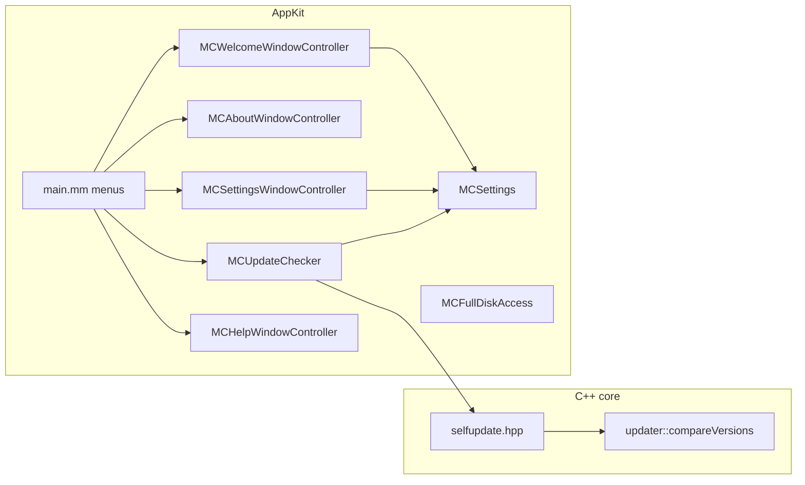

# Standard app dialogs — design

Date: 2026-11-01. Branch: `dialogs-develop` (from `main` at `78c86de`).

## Goal

Give MacCleaner the windows, menus and dialogs that users expect from a
macOS app: About, Settings, Check for Updates, What's New, a first-launch
tutorial, Help, a Full Disk Access guide, Report an Issue, and complete
Edit and View menus.

Success:

- Every item below opens from the menu bar with its standard shortcut.
- Settings change the behavior that they name, and the values persist
  after a restart.
- "Check for Updates" finds a newer GitHub release and reports "up to
  date" when there is none.
- With offline mode on, the app makes no network request.

## Decisions

- **AppKit only.** Each dialog is a small `NSWindowController` or sheet,
  like the existing tools. No SwiftUI `Settings` scene: the app life cycle
  is AppKit, and a hosting bridge adds a second UI convention.
- **Update source: GitHub Releases.** No Sparkle, no automatic download or
  install. The repository is public, so the API needs no token.
- **Offline content.** Help, What's New and the tutorial are bundle
  resources. Only the update check uses the network.
- **One settings store.** `MCSettings` wraps `NSUserDefaults` with
  registered defaults. No other code reads the defaults keys directly.

## Non-goals

- No Sparkle, appcast or EdDSA signing.
- No Apple Help Book (`.help` bundle, `hiutil`).
- No coach marks on the tool views.
- No telemetry and no crash reporter.
- No markdown rendering. The deployment target is macOS 11, and
  `NSAttributedString` markdown needs macOS 12. Release notes from GitHub
  show as plain text.

## Components



## Core: `include/maccleaner/selfupdate.hpp`, `src/selfupdate.cpp`

Namespace `maccleaner::selfupdate`. Pure functions, no network.

```cpp
struct Release {
    std::string version;   // tag_name without a leading "v"/"V"
    std::string name;      // "name", else the tag
    std::string notes;     // "body", plain text
    std::string pageUrl;   // "html_url"
};

// The JSON of GET /repos/{owner}/{repo}/releases/latest.
// nullopt if the JSON is malformed, has no tag_name, or html_url does not
// start with "https://github.com/".
std::optional<Release> parseLatestRelease(std::string_view json);

// True if `latest` is newer than `current` (updater::compareVersions,
// after the "v" prefix is removed from both).
bool isNewer(std::string_view latest, std::string_view current);

inline constexpr std::string_view kLatestReleaseUrl =
    "https://api.github.com/repos/ecucuk/MacCleanerTools/releases/latest";
inline constexpr std::string_view kIssuesUrl =
    "https://github.com/ecucuk/MacCleanerTools/issues/new";
```

`/releases/latest` already leaves out drafts and pre-releases. The
`html_url` check keeps the "Download" button from opening a URL that the
response chose.

### CLI

- `mac_cleaner --version` prints `mac_cleaner 0.1.0`. The version comes
  from `PROJECT_VERSION` through a compile definition.
- `mac_cleaner check-update` fetches `kLatestReleaseUrl`. It prints the
  newer version and the page URL (exit 0), or "up to date" (exit 0). A
  network error or a bad response exits 1. HTTP 404 (no release yet) is
  "up to date". The fetch uses `NSURLSession` in a new platform file
  `src/platform/http_mac.mm` (`std::optional<HttpResponse> httpGet(url,
  timeout)`), with a fallback that returns nullopt.

## GUI

### `MCSettings`

Class methods with typed properties over `NSUserDefaults`.
`registerDefaults` runs once in `applicationWillFinishLaunching`.

| Key | Type | Default | Read by |
|---|---|---|---|
| `showSplash` | BOOL | YES | `main.mm` before the splash |
| `launchTool` | enum Home / LastUsed | Home | `MCMainWindowController` |
| `lastTool` | MCTool | Home | written on each tool change |
| `checkUpdatesAtLaunch` | BOOL | YES | `MCUpdateChecker` |
| `lastUpdateCheck` | NSDate | nil | `MCUpdateChecker` |
| `skippedVersion` | NSString | nil | `MCUpdateChecker` |
| `largeFilesMinSizeMB` | NSInteger | the current default of the Large Files view | `MCLargeFilesViewController` |
| `idleHelperRuleDefault` | BOOL | NO | `MCOptimizeSheetController` |
| `appearance` | enum System / Light / Dark | System | `NSApp.appearance` |
| `offlineMode` | BOOL | NO | every network caller |
| `welcomeShown` | BOOL | NO | `MCWelcomeWindowController` |
| `lastSeenVersion` | NSString | nil | `MCWelcomeWindowController` |
| `fullDiskAccessHintSuppressed` | BOOL | NO | `MCFullDiskAccess` |

A change posts `MCSettingsDidChangeNotification`. The appearance setting
applies at once.

### Settings window (⌘,)

An `NSTabViewController` in toolbar style, with four tabs:

- **General:** Show splash at launch; Open at launch (Home / Last used
  tool); Check for updates automatically.
- **Cleaning:** Default mode of Storage Cleaner — fixed to "Move to Trash",
  shown as a disabled control with the text "MacCleaner always starts in
  Trash mode. Choose Delete permanently per clean." The control documents
  the safety model; it does not add a setting. Large Files minimum size
  (MB). Optimize: the idle-helper rule is checked by default (default off).
- **Appearance:** System / Light / Dark.
- **Privacy:** Offline mode, with the text "MacCleaner makes no network
  requests. Check for Updates and the Updater tool are turned off."

### Check for Updates

`MCUpdateChecker` (main-thread API, `NSURLSession` callbacks hop to main).

1. Manual check (menu "Check for Updates…"): always fetches. It shows a
   result dialog in every case: new version, up to date, or the error.
2. Automatic check: at launch, only if `checkUpdatesAtLaunch` is on and the
   last check is 24 h or more ago. It shows a dialog only for a new
   version that is not `skippedVersion`. Errors are silent.
3. The new-version dialog shows the name and the plain-text notes in a
   scroll view. Buttons: "Download" (opens `pageUrl`), "Skip This
   Version", "Later".
4. Request: 10 s timeout, header `Accept: application/vnd.github+json`,
   `User-Agent: MacCleaner/<version>`. HTTP 404 = up to date. HTTP 403 or
   429 = "GitHub rate limit reached. Try again later."
5. With offline mode on, the manual check shows "Offline mode is on" with a
   button that opens Settings › Privacy. The automatic check does nothing.

### Offline mode, other callers

- Updater tool: the Check button is disabled and the hero shows "Offline
  mode is on — Settings › Privacy".
- Uninstaller: the read-only `brew info` call is skipped, so the Homebrew
  note does not show.

### About window

Replaces `orderFrontStandardAboutPanel:`. A fixed-size window with the app
icon, "MacCleaner", "Version 0.1.0 (0.1.0)", the copyright line from
`LICENSE`, and three buttons: "GitHub" (repository page), "License" (shows
the MIT text from a bundled `LICENSE` copy), "Acknowledgements" (a text
that names the system frameworks used; there is no third-party code).

### Welcome window (tutorial and What's New)

One window controller with paged content (`NSPageController` is not
needed; a container view swaps child views). Back / Next / Done buttons
and page dots.

- **Tutorial**, 5 pages: Welcome → The tools (one line per tool, with its
  gradient icon) → Safety (Trash first, nothing is removed without review)
  → Full Disk Access (why, and a button that opens the settings page) →
  Ready.
- **What's New**, 1 page: the HTML of `Resources/WhatsNew.html`, rendered
  with `NSAttributedString initWithHTML:`.
- At launch, after the splash: if `welcomeShown` is NO, show the tutorial
  and set `welcomeShown` and `lastSeenVersion`. Else, if `lastSeenVersion`
  differs from the bundle version, show What's New and update
  `lastSeenVersion`.
- Help menu: "Welcome Tour" and "What's New" open the same window at any
  time.

### Help window (⌘?)

A split window: a source list of topics on the left (Getting Started,
each tool, Safety, Full Disk Access, Command Line), and the topic on the
right. Content: `Resources/Help/<topic>.html`, rendered with
`initWithHTML:` in a read-only `NSTextView`. The Help menu search field is
standard AppKit and needs no code.

### Full Disk Access guide

`MCFullDiskAccess` has one class method `+presentIfNeededForWindow:`. A
tool calls it when an operation fails with EPERM from TCC (today:
Uninstaller rows with "Needs Full Disk Access", Storage Cleaner failures
with EPERM, Large Files walks with EPERM). It shows a sheet once per launch
unless suppressed: the reason, "Open System Settings" (opens
`x-apple.systempreferences:com.apple.preference.security?Privacy_AllFiles`),
"Not Now", and a "Don't show again" checkbox.

### Report an Issue

Help menu item. It opens `kIssuesUrl` with `title` empty and `body`
prefilled: app version, macOS version, and the CPU type. No paths, no
user name, no tool data. It stays enabled in offline mode, because the
app only opens the browser and makes no request itself.

### Menus (`main.mm`)

- **MacCleaner:** About MacCleaner · Check for Updates… · separator ·
  Settings… (⌘,) · separator · Hide (⌘H) · Hide Others (⌥⌘H) · Show All ·
  separator · Quit (⌘Q).
- **Edit:** Undo (⌘Z) · Redo (⇧⌘Z) · separator · Cut (⌘X) · Copy (⌘C) ·
  Paste (⌘V) · Select All (⌘A) · separator · Find (⌘F, focuses the search
  field of the current tool when it has one).
- **View:** Home (⌘0) · one item per tool (⌘1…⌘9 in sidebar order) ·
  separator · Toggle Sidebar (⌃⌘S) · Enter Full Screen (⌃⌘F).
- **Window:** unchanged (Close, Minimize) plus Zoom and Bring All to Front.
- **Help:** MacCleaner Help (⌘?) · Welcome Tour · What's New · separator ·
  Report an Issue… · separator · Full Disk Access….

The View tool items come from the same `MCToolEntry` list as the sidebar,
so a new tool gets its menu item and shortcut without menu code.

## Errors

- Network failure, timeout, rate limit: manual check shows the reason;
  automatic check is silent and does not update `lastUpdateCheck`.
- Malformed release JSON or a foreign `html_url`: "Could not read the
  release information."
- Missing help or What's New resource: the view shows "This page is
  missing." The app does not crash.

## Testing

Unit tests in `tests/maccleaner_tests.cpp`:

- `parseLatestRelease`: a real-shaped response; `v` and `V` prefixes; no
  `name` (falls back to the tag); missing `tag_name`; malformed JSON; a
  `html_url` on another host is rejected.
- `isNewer`: `0.2.0` > `0.1.0`; `v0.1.0` == `0.1.0`; `0.1.10` > `0.1.9`;
  `1.0.0-beta.1` < `1.0.0`; equal versions are not newer.

CLI check: `mac_cleaner --version`; `mac_cleaner check-update` against
the real API (today: no release, so "up to date" through the 404 path).

GUI pass, by the user (Claude has no Accessibility permission):

1. Every menu item and shortcut opens its window.
2. Change each setting, quit, relaunch, and check the value and its effect.
3. Offline mode on: Check for Updates shows the offline message; the
   Updater Check button is disabled.
4. Delete the defaults (`defaults delete com.maccleaner.app`) and relaunch:
   the tutorial shows. Change `lastSeenVersion`: What's New shows.
5. ⌘C / ⌘V work in the search fields.

After the merge, publish the first release `v0.1.0` so that the update
check has a target. That is a separate step and needs the user's go-ahead.
