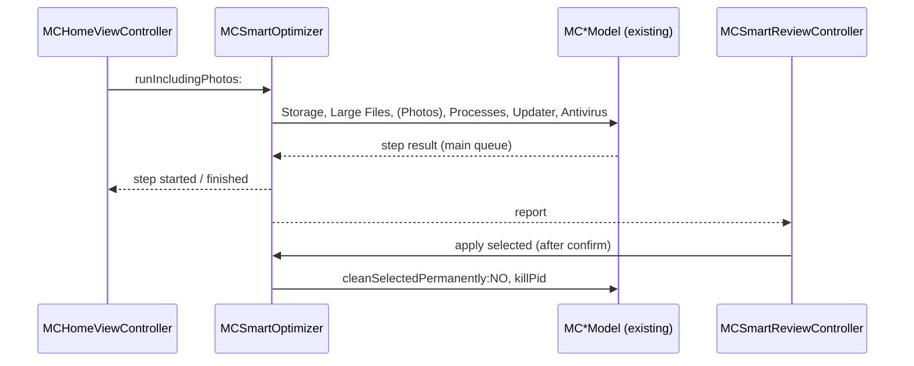

# Theme refresh and Smart Optimize — design

Date: 2026-11-01. Branch: `theme-develop` (from `main`).

## Goal

1. Make the GUI more vivid and animated, in the style of CleanMyMac and
   PearCleaner. Use more specific, modern SF Symbols. Use Liquid Glass on
   macOS 26 and later, with a close fallback on macOS 14–25.
2. Add "Smart Optimize" to Home: one button runs the tools in order, shows
   one combined review, and applies only safe, recommended actions after the
   user confirms.
3. Make the app icon more modern while it keeps its sparkle design.

The deployment target stays macOS 14.0.

Success:

- The build has no warnings. `ctest` passes.
- The new look is verified with screenshots on macOS 26+ (Liquid Glass) and
  on the fallback path.
- Smart Optimize runs live on the real machine up to the review sheet. The
  apply step runs on the real machine after the user confirms.

## Decisions

- **Apply = caches to the Trash + recommended processes.** Large Files,
  Updater, Antivirus and Photos only report. Antivirus findings can be
  persistence items with false positives, so they stay out of any automatic
  path.
- **Photos is an optional step.** A checkbox on Home, off by default. When
  it is on, the step scans `~/Pictures` and reports the number and size of
  similar-photo groups. It never removes photos.
- **"Aurora + glass" visual direction.** Hero, banner and splash get an
  animated aurora background. Buttons, cards and the sidebar badge get a
  glass look. Result lists stay system lists, so light/dark mode, increased
  contrast and accessibility keep working. A full custom dark theme was
  rejected: it ignores the system appearance and needs every list redrawn.
- **No new scan or delete logic in the GUI.** Smart Optimize only
  orchestrates the existing models. The one new rule ("which cleanup
  categories are recommended") lives in the C++ core with a test.

## Part 1: Smart Optimize

### Core

- `bool isRecommendedForAutoClean(Category)` in `include/maccleaner/cleaner.hpp`,
  next to its sibling rule `requiresPermanentDelete`.
  - Recommended: `UserCaches`, `UserLogs`, `DiagnosticReports`,
    `XcodeDerivedData`, `SimulatorCaches`, `HomebrewCache`, `NpmCache`,
    `YarnCache`, `PipCache`. All are regenerated by their owners.
  - Not recommended: `XcodeArchives` (cannot be regenerated),
    `XcodeDeviceSupport` (slow to download again), `Trash` (needs a
    permanent delete).
  - A test checks every category.

### `MCSmartOptimizer` (new, `src/gui/`)

Owns one instance of each existing model and runs the steps in this order.
Every callback is on the main queue, as in the models.

1. **Storage** — `MCScanModel` scan. Afterwards, every entry of a
   recommended category is selected; all other entries stay unselected.
2. **Large Files** — `MCBigFilesModel` under `~`, minimum 500 MB, top 10.
   Report only.
3. **Photos** (only when the checkbox is on) — `MCPhotoModel scanFolder:` on
   `~/Pictures`, then `groupsOfItems:`. Reports the group count and the
   size of the photos other than the first of each group. Report only.
4. **Processes** — `MCProcessModel findOptimizationCandidates`. Only
   `recommended` candidates are selected (the existing model sets this).
5. **Updater** — skipped with "Offline mode" when `MCSettings.offlineMode`
   is on. Otherwise `MCUpdaterModel checkWithCompletion:`; reports the count
   of upgradable items. Report only.
6. **Antivirus** — `MCMalwareModel scanFolder:nil`. Reports the findings.
   Report only.

Rules:

- The user can stop the run. Stop cancels the current step's model
  (`cancelScan` / `cancel`) and goes to the review with what was found.
- A step that fails writes one error line in the report; the run continues.
- The optimizer exposes the step list, each step's state (waiting, running,
  done, skipped, failed) and one summary line per step.

### Review sheet `MCSmartReviewController` (new)

- One section per step.
- Actionable rows have a checkbox: one row per Storage category (the size of
  its selected entries) and one row per process candidate. Defaults come
  from the optimizer.
- Report rows (Large Files, Photos, Updater, Antivirus) have an "Open"
  button that closes the sheet and selects that tool in the sidebar.
- "Move to Trash & Quit Processes" applies only the checked rows:
  1. `MCScanModel cleanSelectedPermanently:NO` — always the Trash. The core
     re-checks `safety::isSafeToDelete` for each path immediately before it
     moves the path.
  2. `MCProcessModel killPid:force:NO` for each checked candidate. The model
     applies `isSafeToKill`. A process that already exited counts as
     success.
- The button is disabled when nothing is checked. Nothing is changed until
  the user presses it.
- After apply, Home shows a sticky summary, for example
  "2.1 GB moved to the Trash, 3 processes quit".

### Home

- A large "Smart Optimize" hero at the top: the round glass button with a
  pulsing halo, and the "Also scan Photos" checkbox below it.
- While the run is in progress: a glass card with the step list; each step
  shows a spinner, a checkmark, "Skipped" or an error mark. A Stop button.
- The tool cards stay below.

## Part 2: Theme

- **Colours.** Each tool's gradient goes from two to three stops and becomes
  more saturated. White text keeps its contrast.
- **`MCAuroraView` (new).** The tool gradient as the base, with three
  blurred radial blobs (`CAGradientLayer`, radial type) that drift slowly
  (12–20 s `CABasicAnimation`, autoreverse). Runs on the GPU, no timers.
  Used by `MCHeroView`, `MCToolBanner` and `MCSplashWindow`.
- **Glass.** `+[MCTheme glassViewWithCornerRadius:]` returns an
  `NSGlassEffectView` on macOS 26+ (`@available`). On macOS 14–25 it
  returns an `NSVisualEffectView` (blending within window) with a rounded
  mask and a thin white border. Used by the Home cards, the step list, the
  banner's number area and the review sheet header.
- **`MCGlassButton`.** Same API. On macOS 26+ the pill styles use
  `NSBezelStyleGlass` with a tint. The round style and the fallback are
  drawn: a bright top edge, an inner shadow, a glow on hover. The round
  button has a pulsing halo.
- **Motion.**
  - Hero ↔ results: crossfade with a small scale.
  - Scanning: the existing spinning ring and pulsing emblem, plus a
    progress arc and three glowing dots in orbit.
  - Home cards: on hover, scale to 1.03 and a deeper shadow.
  - Smart Optimize steps appear one after another.
- **Accessibility.** With "Reduce Motion" on, the aurora, pulse and orbit
  animations stop. With "Reduce Transparency" on, glass becomes a solid
  colour. Light and dark mode keep working.
- **Badges.** Rounded square in the macOS 26 style: the gradient, a glass
  highlight at the top, a soft shadow, a white hierarchical symbol.
- **Symbols.** Each must exist on macOS 14; if one does not, use the
  nearest older symbol.

  | Tool | Symbol |
  |---|---|
  | Storage Cleaner | `bubbles.and.sparkles.fill` |
  | Large Files | `doc.viewfinder.fill` |
  | Photo Cleaner | `photo.stack.fill` |
  | Performance | `bolt.fill` |
  | Organizer | `folder.fill.badge.gearshape` |
  | Antivirus | `checkmark.shield.fill` |
  | Updater | `arrow.down.app.fill` |
  | Uninstaller | `xmark.app.fill` |
  | Home | `house.fill` |
  | Smart Optimize | `wand.and.stars` |

## Part 3: App icon

`tools/make_icon.m`, Core Graphics only, no third-party art.

- Keep the composition: one large four-point sparkle and two small ones.
- Tile: the same squircle on the 824/1024 grid. A deeper three-stop
  gradient and an aurora blob in the Home colours (indigo → cyan).
- Depth: the large sparkle is a separate glass layer — a white to ice-blue
  fill, a thin specular edge, a soft coloured shadow.
- Glass shine: a soft reflection on the top half of the tile, a 1–2 pt
  inner highlight along the edge, a drop shadow under the tile.
- Check legibility at 16, 32, 128 and 1024 px.
- Regenerate `resources/MacCleaner.icns` with `sh tools/build_icon.sh`.

## Out of scope

- Redrawing the result lists of the tools.
- Automatic actions for Large Files, Photos, Updater or Antivirus.
- A CLI subcommand for Smart Optimize (it only combines existing CLI
  commands).

## Testing

- Core: `isRecommendedForAutoClean` for every category, in
  `tests/maccleaner_tests.cpp`.
- GUI: `screencapture -x` of Home, a hero, a banner, the step list, the
  review sheet and the splash, on macOS 26+ and on the fallback path. The
  fallback path is forced with a temporary, uncommitted environment
  variable hook that is removed before commit.
- Smart Optimize: a live run up to the review sheet. The apply step runs on
  the real machine after the user confirms.
- README: Smart Optimize, the safety rules of the apply step, the new look.
